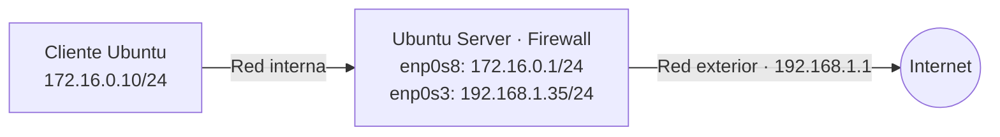
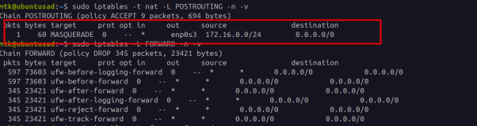
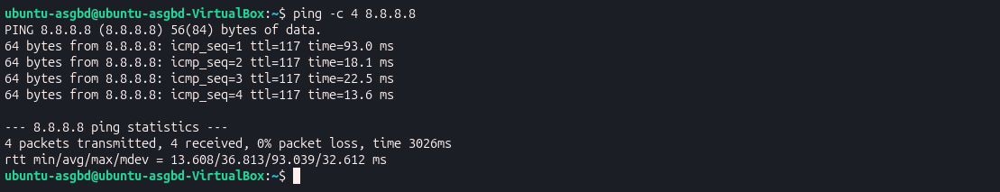
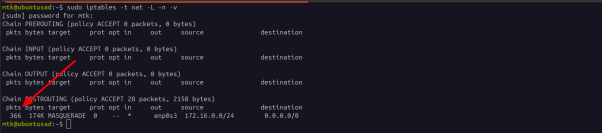
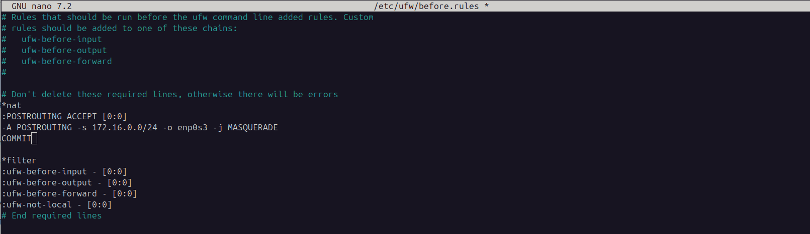

# Firewall Linux con UFW, iptables y NAT

**Mini Lab · Ubuntu Server · Seguridad perimetral**

En este laboratorio se ha configurado un servidor Ubuntu como cortafuegos y puerta de enlace para una red interna. Se ha utilizado **UFW** para gestionar el filtrado, **iptables** para configurar NAT y el reenvío IPv4 para permitir que un cliente acceda a Internet a través del servidor.

## Topología de red



El cliente utiliza `172.16.0.1` como puerta de enlace y `1.1.1.1` como servidor DNS.

## 1. Configuración del cortafuegos

Se ha activado UFW y se han permitido las conexiones SSH (22/TCP) y HTTPS (443/TCP). Se ha comprobado que el tráfico entrante no autorizado quedaba bloqueado por defecto.

```bash
sudo ufw allow 22/tcp
sudo ufw allow 443/tcp
sudo ufw enable
sudo ufw status verbose
```

También se han revisado las cadenas de `iptables` para comprobar las políticas de filtrado.

## 2. Enrutamiento IPv4 y NAT

Al principio, el cliente podía comunicarse con el servidor, pero no tenía acceso a Internet. Se ha activado el reenvío IPv4 y se ha añadido una regla `MASQUERADE` para la red interna.

```bash
sudo sysctl -w net.ipv4.ip_forward=1
sudo iptables -t nat -A POSTROUTING -s 172.16.0.0/24 -o enp0s3 -j MASQUERADE
sudo ufw route allow in on enp0s8 out on enp0s3 from 172.16.0.0/24
```



## 3. Pruebas de funcionamiento

Se ha comprobado la conexión desde el cliente mediante `ping` a `8.8.8.8` y a un dominio, además de abrir una página web desde Firefox. Después de configurar NAT y el reenvío, las pruebas han funcionado.



También se han revisado los contadores de `iptables`. Los paquetes de la regla `MASQUERADE` han aumentado de **1 a 366**, lo que ha permitido verificar que el tráfico utilizaba la regla configurada.



## 4. Persistencia de la configuración

Para evitar que la configuración se perdiera al reiniciar, se ha habilitado el reenvío IPv4 en `/etc/ufw/sysctl.conf`:

```ini
net/ipv4/ip_forward=1
```

Además, se ha añadido la regla NAT a `/etc/ufw/before.rules`:

```text
*nat
:POSTROUTING ACCEPT [0:0]
-A POSTROUTING -s 172.16.0.0/24 -o enp0s3 -j MASQUERADE
COMMIT
```

Se ha eliminado la regla NAT temporal, se ha recargado UFW y se ha comprobado que la regla volvía a aparecer.



## 5. Resultado

Se ha conseguido que un cliente de la red interna acceda a Internet a través del servidor Ubuntu, manteniendo el filtrado de UFW. Las pruebas de conectividad y los contadores de `iptables` han servido para comprobar el funcionamiento del enrutamiento y de NAT.

> **Documentación completa:** [Ver memoria de la práctica (PDF)](docs/firewall-ubuntu.pdf)

---

*Laboratorio realizado en un entorno virtual de aprendizaje de ASIR.*
